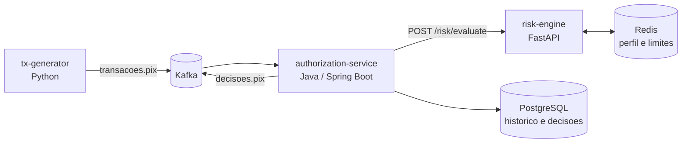

# Arquitetura

## Decisoes de design (ADRs resumidos)

1. **Regras antes de ML.** Comecamos com regras explicaveis; um modelo (ex.: Isolation Forest) entra como evolucao.
2. **Chamada sincrona ao risk-engine com timeout curto.** A decisao precisa ser rapida; o Kafka cuida da ingestao e do registro de eventos.
3. **Redis para perfil do usuario, PostgreSQL para historico.** Leitura em milissegundos vs. consulta analitica.
4. **Tudo local e gratuito primeiro** (Docker Compose); nuvem fica como fase opcional.
5. **Falha da engine nunca aprova no escuro.** Se a engine estiver fora do ar ou lenta, a transacao vai para `EM_REVISAO` com o motivo `engine_indisponivel`.
6. **Mensagens invalidas vao para uma DLQ** (`transacoes.pix.dlq`), sem travar o consumo das demais.
7. **Commit do offset so depois de publicar a decisao**, para nao perder transacoes se o servico cair no meio.
